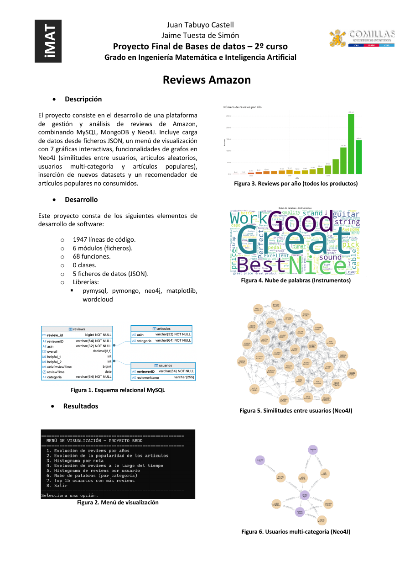

# Amazon Reviews with MySQL, MongoDB and Neo4j

**Authors:** Juan Tabuyo Castell and Jaime Tuesta de Simón
**Context:** Final project of *Bases de Datos* (Databases), 2nd year, Universidad Pontificia Comillas (ICAI), April 2026.
**Language:** code comments, console messages, report and poster are in Spanish; this README is in English.

## Overview

A small data platform for about 770,000 Amazon product reviews. It splits the data between a relational and a document database, visualises it, models it as graphs and makes simple recommendations:

- **Data loading.** The JSON files are read line by line and inserted in batches. Structured fields go to **MySQL**; free text goes to **MongoDB**.
- **Visualisation.** A terminal menu shows seven charts built from MySQL and MongoDB queries: reviews per year, item popularity, rating histogram, cumulative reviews over time, reviews per user, a word cloud of review summaries and the most active users.
- **Graph analysis with Neo4j.**
  - Pearson similarity between the 30 most active users.
  - Random items and the users who rated them.
  - Users active in several categories.
  - Users who share popular items.
- **Incremental loading.** A new category is added to the existing databases without duplicating users or items that are already stored.
- **Recommendation.** For a given user and category, the ten most popular items the user has not reviewed yet, computed with a single SQL query.



## Data

The project uses the 5-core subsets (every user and every item has at least five reviews) of the [Amazon product data (2014)](https://cseweb.ucsd.edu/~jmcauley/datasets/amazon/links.html) by Julian McAuley (UCSD):

| Category | File | Reviews |
|---|---|---:|
| Toys and Games | `Toys_and_Games_5.json` | 167,597 |
| Video Games | `Video_Games_5.json` | 231,780 |
| Digital Music | `Digital_Music_5.json` | 64,706 |
| Musical Instruments | `Musical_Instruments_5.json` | 10,261 |
| Sports and Outdoors (added later) | `Sports_and_Outdoors_5.json` | 296,337 |

The files are not included in this repository. Download the 5-core files of these categories from the dataset page, decompress them and put them in a `data/` folder next to the scripts, with the names in the table (rename them if the downloaded names differ). If you use the data, cite the papers listed on the dataset page.

## Database design

**MySQL** stores the structured fields in three tables:
- `usuarios(reviewerID PK, reviewerName)`
- `articulos(asin PK, categoria)`
- `reviews(review_id PK, reviewerID FK, asin FK, overall, helpful_1, helpful_2, unixReviewTime, reviewTime DATE, categoria)`

The category is repeated in `reviews` so that charts can filter by category without a join.

**MongoDB** stores the free-text fields (`reviewText`, `summary`) in the `reviews_texto` collection, with the ids, timestamp and category as metadata.

**Neo4j** is filled on demand from MySQL by the graph menu.

The report explains each decision in detail.

## How to run

**Requirements**
- Python 3.10 or newer.
- A local MySQL server on port 3306.
- A local MongoDB server on port 27017.
- A local Neo4j server with the Bolt protocol on port 7687.

Hosts, ports, users and database names can be changed in `configuracion.py`.

```bash
python -m venv .venv
source .venv/bin/activate        # Windows: .venv\Scripts\activate
pip install -r requirements.txt
```

**Credentials.** Passwords are not stored in the code. `configuracion.py` reads them from two environment variables:

```bash
export MYSQL_PASSWORD="..."      # Windows (PowerShell): $env:MYSQL_PASSWORD="..."
export NEO4J_PASSWORD="..."      # Windows (PowerShell): $env:NEO4J_PASSWORD="..."
```

**Scripts**, in this order:

```bash
python load_data.py                  # create the databases, tables, collection and indexes; load the four files
python menu_visualizacion.py         # visualisation menu
python neo4JProyecto.py              # Neo4j menu (open Neo4j Browser at http://localhost:7474 to see the graphs)
python inserta_dataset.py            # add Sports and Outdoors as the new category "Deportes"
python recomendacion_populares.py    # top-10 popular items a user has not reviewed, for a chosen category
```

Running `load_data.py` again drops and recreates the tables and the collection.

## Repository structure

```
├── configuracion.py            # connection settings, database names, data paths
├── load_data.py                # database creation and initial load
├── menu_visualizacion.py       # visualisation menu (MySQL + MongoDB)
├── neo4JProyecto.py            # graph menu (MySQL -> Neo4j)
├── inserta_dataset.py          # incremental load of a new category
├── recomendacion_populares.py  # popularity-based recommendation
├── report/
│   ├── Memoria_Proyecto_BBDD.pdf   # project report (Spanish)
│   ├── memoria.tex                 # LaTeX source of the report
│   └── figs/                       # charts and screenshots used in the report
├── docs/
│   ├── Poster_Proyecto_BBDD.pdf    # project poster (Spanish)
│   └── poster_preview.png
├── requirements.txt
└── README.md
```

## Changes made for publication

- **`configuracion.py`:**
  - Passwords are read from environment variables instead of being written in the file.
  - Data paths are relative to a `data/` folder instead of absolute local paths.
- **`inserta_dataset.py`:** the summary now reports the number of distinct users that already existed. It previously printed the number of reviews minus the number of new users. The data inserted is unchanged.
- **`neo4JProyecto.py`:** categories are read from the database instead of a fixed list, so a category added with `inserta_dataset.py` can also be chosen in the random-items option.
- **Report:** rewritten in a new format, with a short introduction added and the recommendation diagram redrawn; the rest of the content is unchanged. Student ID numbers were removed.
- **Poster:** the code statistics were updated to match the published code.
